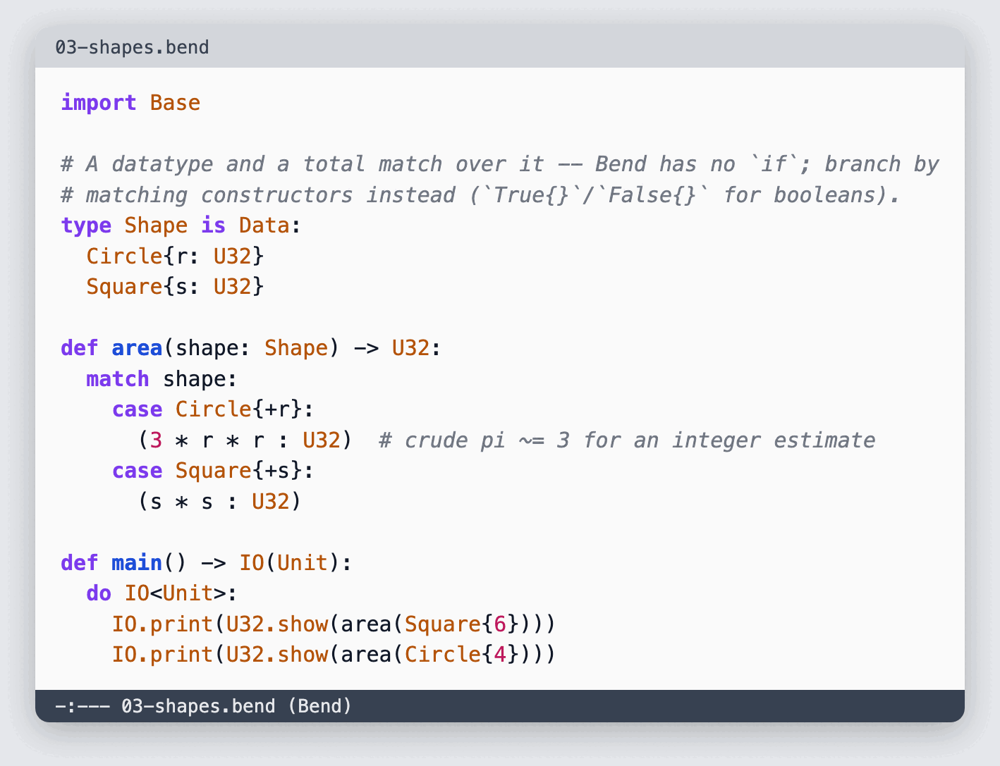

# bend-mode.el

Emacs support for Bend 2: syntax highlighting, indentation, Eglot formatting, Flymake diagnostics and an optional tree-sitter mode.



More renders, and the command that reproduces each: [docs/showcase.md](docs/showcase.md).

An Emacs major mode for [Bend 2](https://github.com/bendlang/bend), a
dependently typed, affine, Python-shaped language whose compiler targets
native CPU, Metal/CUDA and JS.

Bend 2 is a fresh rewrite — the compiler repo now belongs entirely to Bend 2,
and the editor ecosystem that existed for Bend 1 (tree-sitter, VS Code, Zed,
Neovim, IntelliJ, two LSPs) targets the old syntax and does not apply. As of
2.0.22, Bend 2 itself ships only a Sublime Text grammar (for the docs site)
and a formatting-only language server. Neither version has ever had Emacs
support before this package, as far as I could find.

Two upstream PRs adding a Bend 2 VS Code extension and a compiler-backed LSP
were both closed on 2026-09-20 with the same message from the maintainer: this
kind of tooling belongs in its own repo, not the compiler repo, and upstream
will happily link to it. This package takes that invitation.

## What it does

- **Syntax highlighting**: line comments (`# ...`) and block comments
  (`#{ ... #}`, depth-aware for arbitrarily nested pairs via a manual
  counting scan — see `bend-mode-syntax-propertize`'s docstring), strings,
  char literals, keywords, the name in `def NAME`/`law NAME`, uppercase
  type/constructor names, numeric literals (`U32`, `F32`, `Nat` with its `n`
  suffix), quantity markers (`&0` `&1` `&2`), and `?hole`/`?TODO` goals.
- **Indentation**: Bend 2 uses Python-shaped off-side blocks. `bend-mode`
  copies the previous code line's indentation, adding one level
  (`bend-mode-indent-offset`, default 2, matching every example in Bend's own
  guide) when that line ends in `:`. It does **not** dedent automatically —
  aligning a new `case` back with an earlier sibling, or closing a block, is
  a manual `indent-line-to`/`<backtab>`. See Roadmap.
- **Eglot**: registers Bend's own formatting language server
  (`bend2-fmt-lsp --stdio`) for `bend-mode`, so `M-x eglot` +
  `eglot-format-buffer` formats on demand. That server exposes no
  diagnostics, completion, or hover by design — see its own README in the
  `bend` checkout (`tools/bend-fmt-lsp`).
- **Flymake** (`bend-mode-flymake.el`, load separately): shells out to
  `bend FILE --check-only` and parses its checker-error format into
  diagnostics. This is the "cheap approximation" a closed VS Code PR
  described — bend stops at its first error, so at most one diagnostic
  surfaces per check; no hover, no completion. Replace this file outright
  the day a real Bend 2 LSP reports diagnostics itself.

- **Tree-sitter** (`bend-ts-mode`, `src/bend-ts-mode.el`, Emacs 29+): the
  same faces from [tree-sitter-bend2](https://github.com/davidawad/tree-sitter-bend2),
  tree-based indentation that dedents `case` clauses and wrapped arguments,
  Imenu (Def / Type / Law) and defun navigation. It derives from `bend-mode`,
  so the keymap, syntax table, Eglot wiring and Flymake backend are shared.
  See [Tree-sitter mode](#tree-sitter-mode).

## Install

Bend 2 itself first:

```sh
curl -fsSL https://bend-lang.com/install.sh | sh
# review the script before piping it to sh if you'd rather not take that on faith
export PATH="$HOME/.bend/bin:$PATH"
```

### straight.el

```elisp
(straight-use-package
 '(bend-mode :type git :host github :repo "davidawad/bend-mode.el"
             :files ("src/bend-mode.el" "src/bend-mode-flymake.el"
                     "src/bend-ts-mode.el")))
```

### use-package + straight.el

```elisp
(use-package bend-mode
  :straight (:type git :host github :repo "davidawad/bend-mode.el"
             :files ("src/bend-mode.el" "src/bend-mode-flymake.el"
                     "src/bend-ts-mode.el"))
  :mode "\\.bend\\'"
  :hook (bend-mode . flymake-mode))
```

### Manual

Clone this repo and add its `src/` directory to your `load-path`, then:

```elisp
(add-to-list 'load-path "/path/to/bend-mode.el/src")
(require 'bend-mode)
(require 'bend-mode-flymake)  ; optional: flymake diagnostics
(require 'bend-ts-mode)       ; optional: tree-sitter mode (Emacs 29+)
```

`bend-mode.el` alone registers `bend-mode` for `*.bend` files and wires up
Eglot; `bend-mode-flymake.el` is a separate, optional `require` (see its
file header for why it's split out).

## Tree-sitter mode

`bend-ts-mode` needs the tree-sitter-bend2 grammar, pinned to revision
`8ad225d157f7409b59c995a11a86908123b9b20c` (`bend-ts-mode-grammar-revision`).
Install it once (needs git and a C compiler):

```
M-x bend-ts-mode-install-grammar
```

That clones the grammar, checks out the pinned revision and builds
`libtree-sitter-bend` into `~/.emacs.d/tree-sitter`. (Emacs 30's own
`treesit-install-language-grammar` cannot check out a bare commit hash, so
the installer does the pinning itself; the `bend` entry it adds to
`treesit-language-source-alist` is for the default branch.) The grammar's
internal name is `bend2`; `treesit-load-name-override-list` maps the Emacs
language `bend` onto its `tree_sitter_bend2` symbol.

Once the grammar is installed, `.bend` files open in `bend-ts-mode`
automatically (`major-mode-remap-alist`); without it they open in the regex
`bend-mode`, with a one-time message. Set `bend-ts-mode-prefer-treesit` to nil
to always use the regex mode. Calling `M-x bend-ts-mode` directly without the
grammar signals an error naming the installer.

Font-lock level 3 (the default) matches the regex mode's faces; level 4 adds
parameters, operators and punctuation. Indentation caveat: indentation *is*
syntax in Bend, so the tree only describes code that is already laid out
sensibly. Re-indenting well-formed code is a no-op; on a blank new line, or
code the parser cannot read, the rules fall back to `bend-mode`'s
copy-the-previous-line rule. Measured against `formatBend` output
(bend2-fmt-lsp) on 220 real Bend 2 files, re-indenting leaves 94.3% of the
146,390 non-blank lines unchanged (114 files byte-identical); what is left is
mostly deeper continuation nesting, which depends on how the author wrapped
the line.

## Flymake diagnostics

`bend-mode` (and so `bend-ts-mode`) registers the backend buffer-locally on its own; turning on
`flymake-mode` is the only wiring left to you:

```elisp
(add-hook 'bend-mode-hook #'flymake-mode)
```

It runs `bend-mode-command` (default `"bend"`, customize to an absolute path
if `~/.bend/bin` isn't on Emacs's `exec-path`) on every check. An unsaved
buffer is checked via a same-directory temp file (relative `import ./x.bend`
needs the real directory), deleted afterward.

## Formatting via Eglot

Requires `bend2-fmt-lsp`. It isn't published to any package registry yet,
so `bend-mode` builds it for you from Bend's own repository (needs git and
Node.js 22+ with npm):

```
M-x bend-mode-install-fmt-lsp
```

That sparse-clones `tools/bend-fmt-lsp` at `bend-mode-fmt-lsp-ref`
(default `main`), builds it, and installs it with `npm install -g --prefix
~/.bend`, so the executable lands in `~/.bend/bin` next to `bend` itself.
Run it again to update. Eglot finds the server on `exec-path` first, then
falls back to `bend-mode-fmt-lsp-prefix`/bin, so `~/.bend/bin` doesn't
need to be on `PATH`.

Then:

```elisp
(add-hook 'bend-mode-hook #'eglot-ensure)
```

## Tests

ERT tests live in `test/bend-mode-test.el`. The flymake tests exercise only
the pure parsing functions against canned `bend --check-only` output — no
`bend` process is spawned, so the whole suite runs offline with no toolchain
installed:

```sh
emacs -Q --batch -L src -l test/bend-mode-test.el \
  -f ert-run-tests-batch-and-exit
```

The `bend-ts-mode` tests need the grammar. The test setup uses an installed
one, or builds the pinned one into a temp directory (network, git and a C
compiler); if that is not possible they are skipped.

## Examples

`examples/` holds small, checked-against-the-real-compiler Bend 2 programs
(bend 2.0.22) meant to double as a live smoke test for this mode -- open one,
confirm highlighting/indentation look right, and optionally run it:

| File | Demonstrates |
| --- | --- |
| `01-hello.bend` | Minimal `IO` program; the `(expr : T)` operator-annotation rule |
| `02-parallel-pow2.bend` | Fork/join "parallel let" -- Bend's headline feature |
| `03-shapes.bend` | An ADT and a total `match` (no `if` in Bend) |
| `04-arrays.bend` | Affine `Array<T>` ownership threading -- and the two gotchas that tripped this repo's own author on the first try (see its comments) |
| `05-lists.bend` | `List.map`/`List.foldl` with an explicit quantity argument |
| `06-law-and-proof.bend` | A `law` + its proving `def` -- Bend's "blocks AI mistakes via proof" claim, made concrete |

```sh
bend examples/02-parallel-pow2.bend   # -> 1024
```

## Roadmap

- Smart dedent (aligning a new `case`/`elif`/sibling block back to its
  matching level automatically, `python-indent`-style) — the current
  indentation is deliberately the simplest correct v1.
- Drop `bend-mode-flymake.el` in favor of Eglot diagnostics the moment a
  real compiler-backed Bend 2 LSP exists (see
  [bendlang/bend#865](https://github.com/bendlang/bend/pull/865) for the
  prior art and why it wasn't merged upstream).
- Tree-based indentation for wrapped continuation lines that matches
  `bend2-fmt-lsp` in every nesting case, and a `locals`-style query for
  scope-aware highlighting.

## License

MIT — see [LICENSE](LICENSE).
