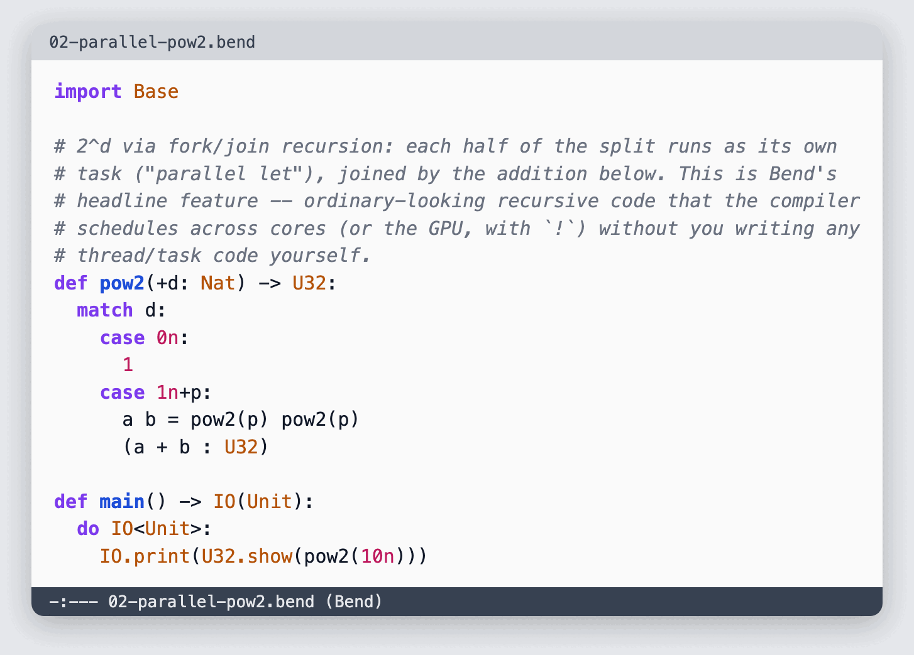
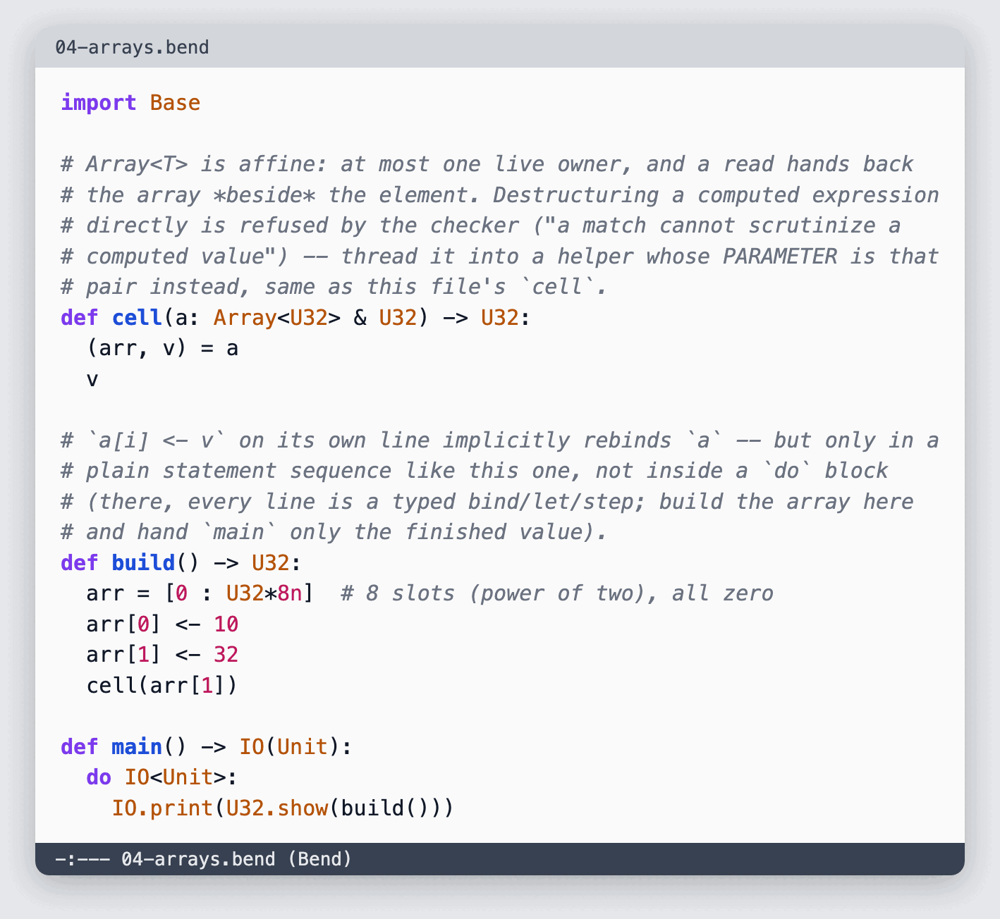
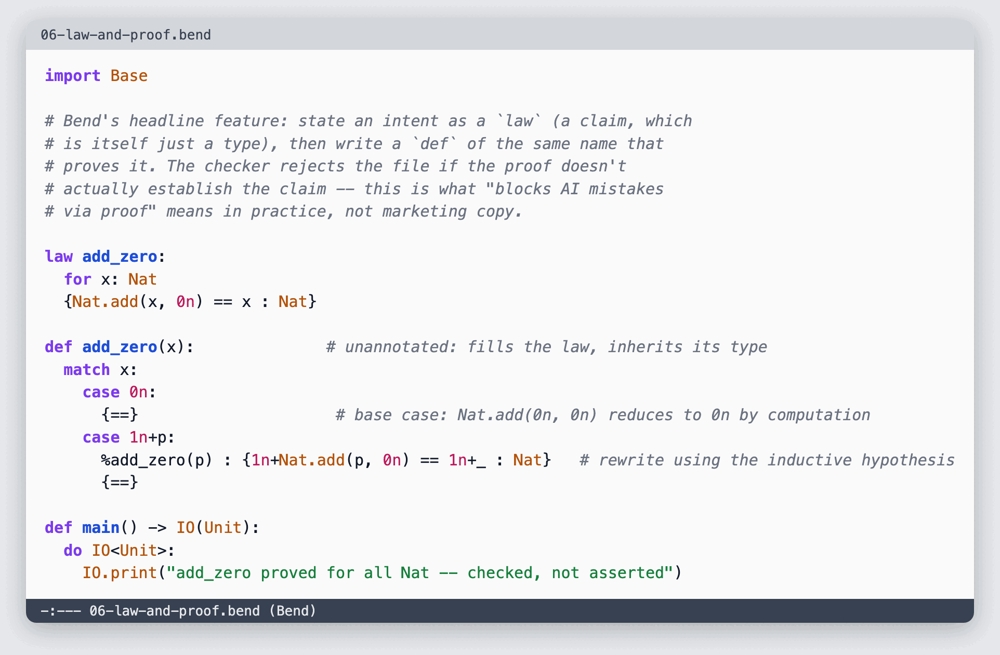

# Showcase

Every image here is generated from the programs in `examples/` by one
script, with no hand editing:

```sh
docs/showcase/make-screenshots.sh
```

Real `bend-mode` font-lock fontifies each file in `emacs -Q --batch`
(`docs/showcase/render.el`), and headless Google Chrome rasterises the
result. Batch Emacs has no color support, so `render.el` maps each
font-lock face to a fixed color; the colors are not your theme's. Needs
`emacs`, Google Chrome and ImageMagick (`magick`). Override the browser
path with `CHROME=/path/to/chrome`.

| Image | Source | Shows |
| --- | --- | --- |
| `docs/showcase/03-shapes.png` | `examples/03-shapes.bend` | `type`, `def`, `match`/`case`, type names, numbers, comments |
| `docs/showcase/02-parallel-pow2.png` | `examples/02-parallel-pow2.bend` | Fork/join parallel let |
| `docs/showcase/04-arrays.png` | `examples/04-arrays.bend` | Affine `Array<T>` ownership threading |
| `docs/showcase/06-law-and-proof.png` | `examples/06-law-and-proof.bend` | `law` + proving `def`, `Nat` literals (`0n`, `1n+p`) |

Not shown: Flymake diagnostics and Eglot formatting, which need a live
Emacs frame and the `bend` toolchain.




